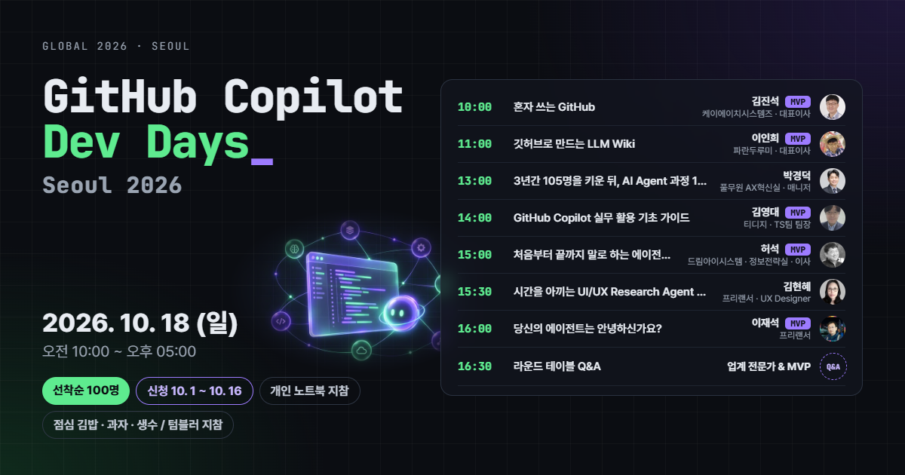
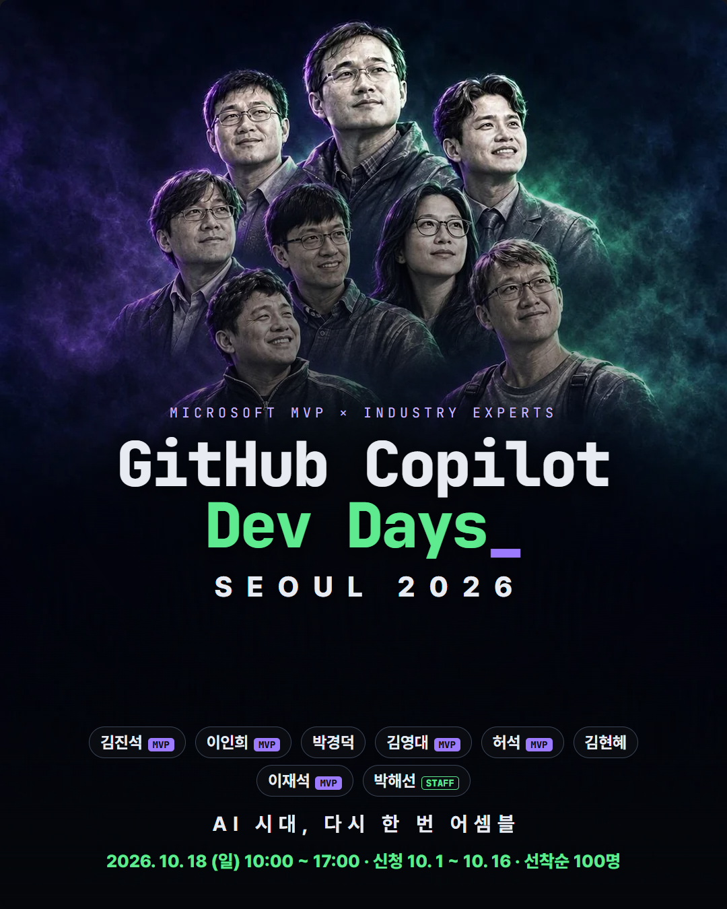
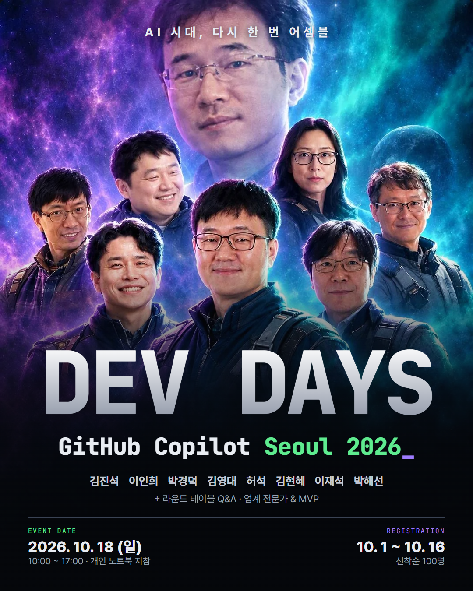
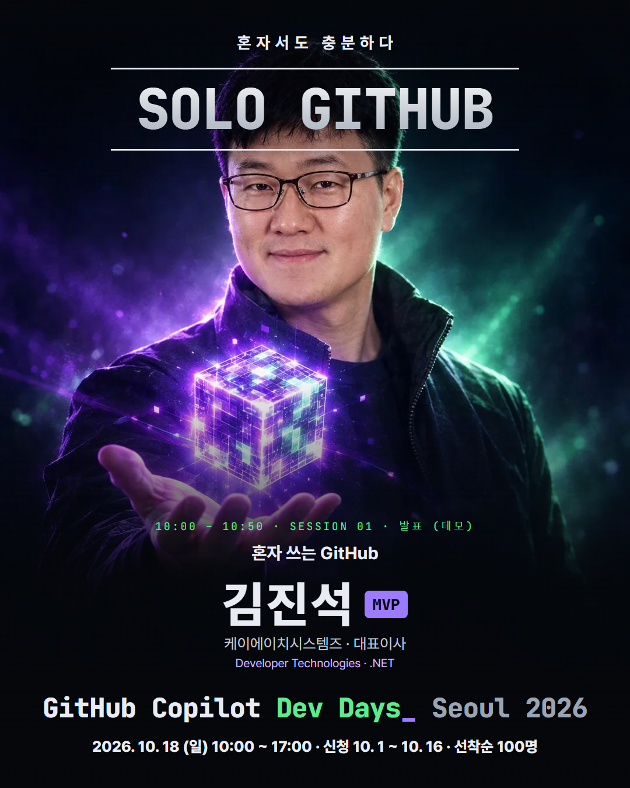
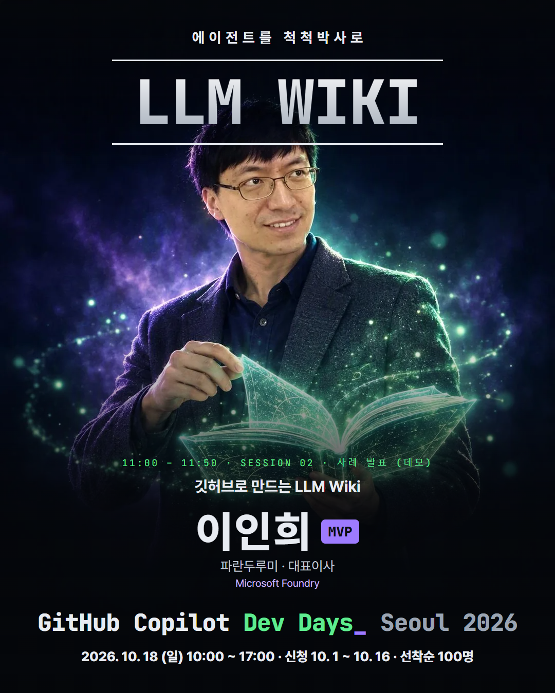
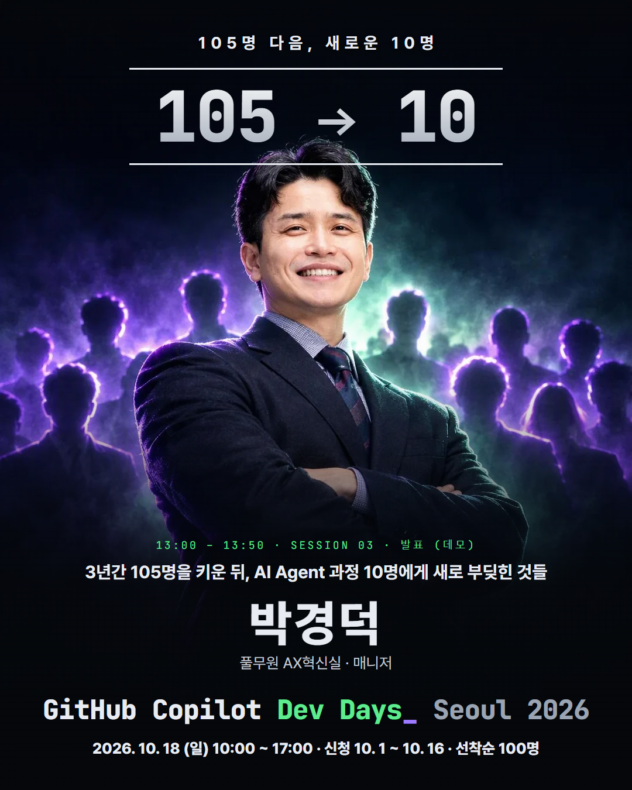
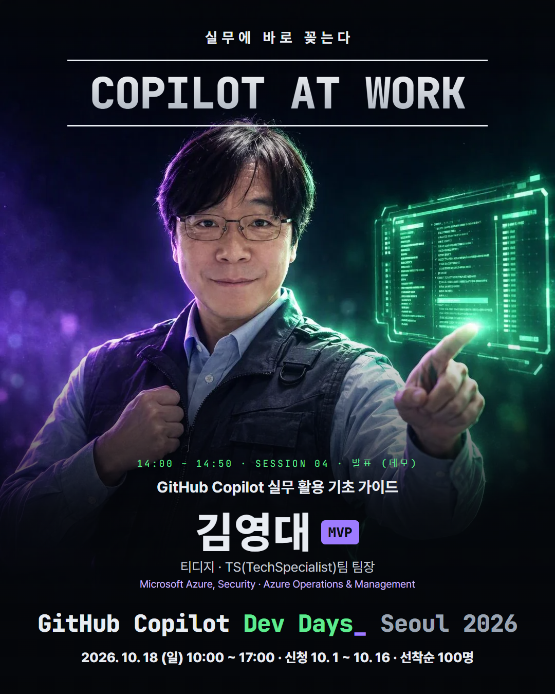
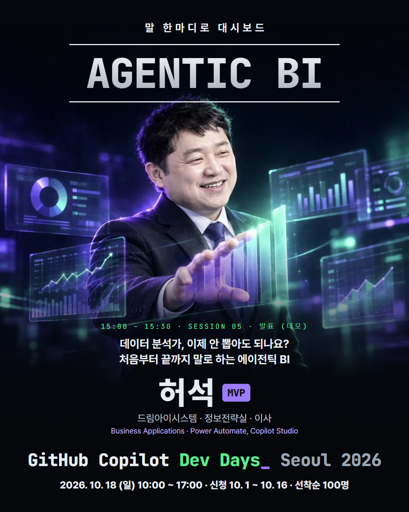
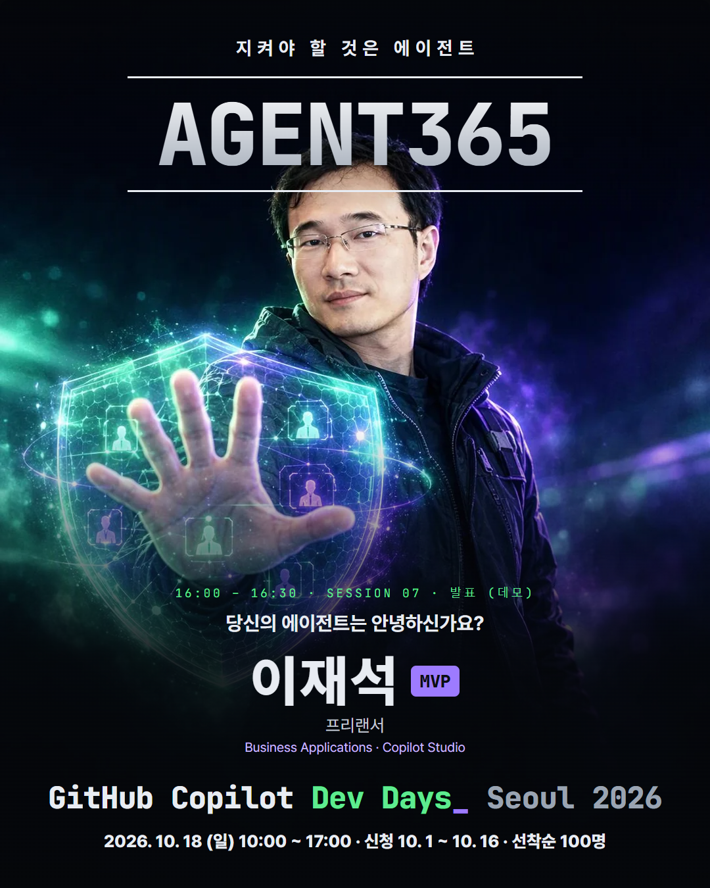

# GitHub Copilot Dev Days Seoul 2026

글로벌 GitHub Copilot Dev Days(9/1 ~ 10/31, 전 세계 오프라인 커뮤니티 이벤트)의 서울 행사 자료입니다.

- **안내 페이지**: https://power-platform-users-korea.github.io/copilot-dev-days-seoul-2026/
- **Power BI 에이전트 실습 매뉴얼**: https://power-platform-users-korea.github.io/copilot-dev-days-seoul-2026/powerbi-agent/
- **신청**: https://event-us.kr/m/136275/62279
- **일시**: 2026. 10. 18 (일) 10:00 ~ 17:00
- **모집**: 2026. 10. 1 (목) ~ 10. 16 (금), 선착순 100명
- **대상**: 비개발자. Microsoft MVP와 업계 전문가가 GitHub, GitHub Copilot, Power Platform이 실무에서 어떻게 만들어지고 활용되는지 비개발자의 관점에서 이야기합니다.
- **식사**: 점심 김밥, 간식 제공 · 음료는 생수만 제공되니 텀블러를 챙겨 주세요
- **오거나이저**: 이재석, 허석 · **스탭**: 박해선, 이인희, 김현혜 · **장소 후원**: 한국마이크로소프트

## 폴더

| 폴더 | 내용 |
| --- | --- |
| [`guide/`](guide/) | 안내 페이지(`index.html`)와 전체 캡처 이미지(`guide-page.png`) |
| [`posters/`](posters/) | 영화 포스터 스타일 홍보 이미지 9장 (단체 2, 발표자 7), 1080×1350 |
| [`banners/`](banners/) | SNS 배너 3장: Facebook 1200×630, LinkedIn 1200×1200, Instagram 1080×1350 |
| [`powerbi-agent/`](powerbi-agent/) | 허석 세션 참고 자료. Power BI 에이전트 한국어 실습 매뉴얼과 [`kit/`](powerbi-agent/kit/)의 교육용 가상 데이터 실습 패키지 |
| [`llm-wiki/`](llm-wiki/) | 이인희 세션 강의 페이지. 스크롤을 따라 진행하는 LLM Wiki·온톨로지 탐험기이며, 발표 모드에서는 화살표 키로 장면을 넘기고 M으로 지도, T로 타이머를 엽니다. [`llm-wiki/kit/`](llm-wiki/kit/)에는 온톨로지와 위키 뼈대를 만들고 검사하고 깃허브·SharePoint에 올리는 PowerShell 키트가 있습니다 |

## 프로그램

### Power BI 에이전트 실습 자료

- [한국어 인터랙티브 매뉴얼](powerbi-agent/): 기존 디자인과 본문을 유지한 웹 매뉴얼입니다. 이후 수정은 `powerbi-agent/index.html`에 반영합니다.
- [실습 패키지 ZIP](powerbi-agent/kit/K_Retail_PowerBI_Agent_실습패키지_통합본.zip): CSV 5종, 테마 JSON, 실습 가이드, 원본 HTML 매뉴얼이 포함되어 있습니다.
- 고객·매출 데이터는 교육용 가상 데이터입니다. ZIP 내 HTML은 최초 제공본이며, 최신 매뉴얼은 웹페이지를 참고하세요.
- 웹 매뉴얼 STEP 1·2에서 Claude Code, VS Code의 Copilot Chat, Codex 확장, Copilot CLI, Windows PowerShell, Mac Bash별 설치·폴더 지정 안내와 복사할 프롬프트/명령어를 선택할 수 있습니다. PowerShell 안내는 Copilot CLI로 이어지며, Mac은 도구 준비만 가능합니다. Desktop·로컬 MCP 실습은 같은 Windows 환경에서 실행합니다.
- STEP 2는 모델 연결 확인만 진행합니다. STEP 3은 측정값 설계(3-1) → 승인 후 생성(3-2) → 숫자 검증·저장(3-3)으로 나뉘며, 각각 목적·복사 프롬프트·완료 기준을 제공합니다. 이후 STEP 4는 보고서 생성, STEP 5는 테마 적용, STEP 6은 최종 확인입니다.

| 시간 | 세션 | 발표자 |
| --- | --- | --- |
| 10:00–10:50 | 혼자 쓰는 GitHub | 김진석 |
| 11:00–11:50 | 깃허브로 만드는 LLM Wiki - 에이전트를 척척박사로 만들어 볼까요? | 이인희 |
| 13:00–13:50 | 3년간 105명을 키운 뒤, AI Agent 과정 10명에게 새로 부딪힌 것들 | 박경덕 |
| 14:00–14:50 | GitHub Copilot 실무 활용 기초 가이드(Azure DevOps, Confluence 연동 등) | 김영대 |
| 15:00–15:30 | 데이터 분석가, 이제 안 뽑아도 되나요? 처음부터 끝까지 말로 하는 에이전틱 BI | 허석 |
| 15:30–16:00 | 시간을 아끼는 UI/UX Research Agent 어떠세요? | 김현혜 |
| 16:00–16:30 | 당신의 에이전트는 안녕하신가요? | 이재석 |
| 16:30–17:00 | 라운드 테이블 Q&A | 업계 전문가 & MVP |

## 포스터

| | | |
| --- | --- | --- |
|  |  |  |
|  |  |  |
|  |  |  |

포스터 인물 이미지는 발표자가 제공한 사진을 참조해 Azure AI Foundry 이미지 모델로 생성했습니다.
